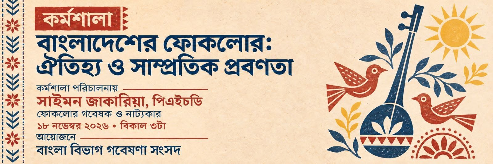
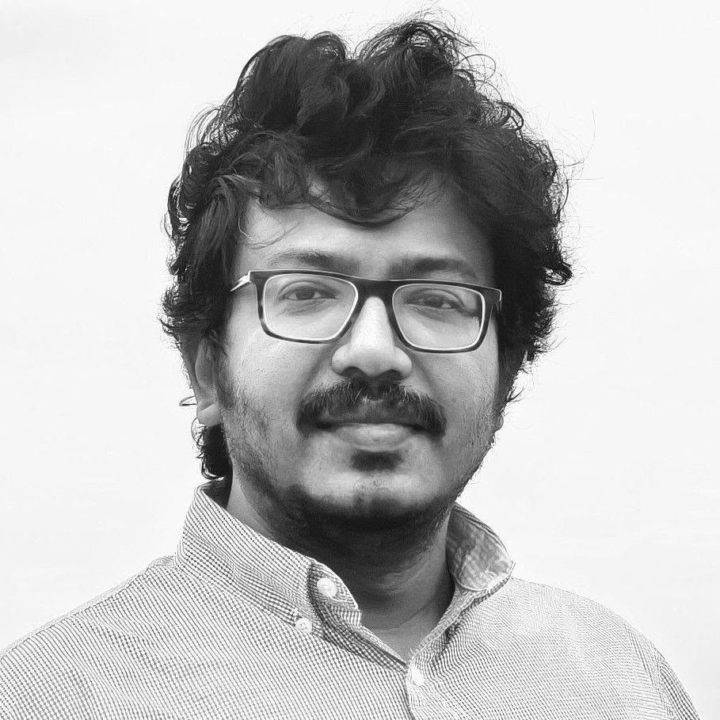
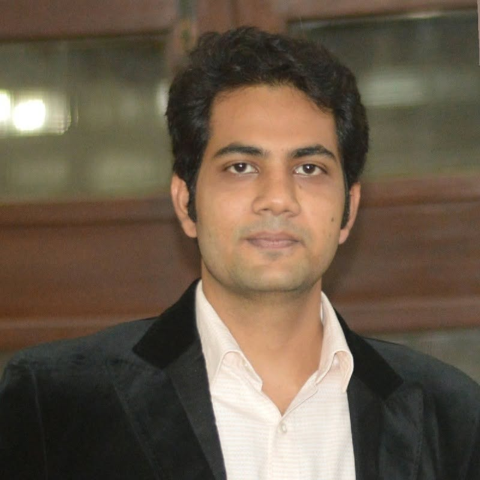
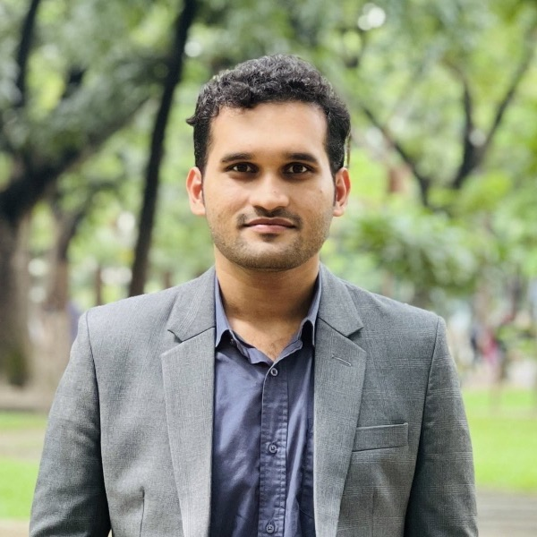
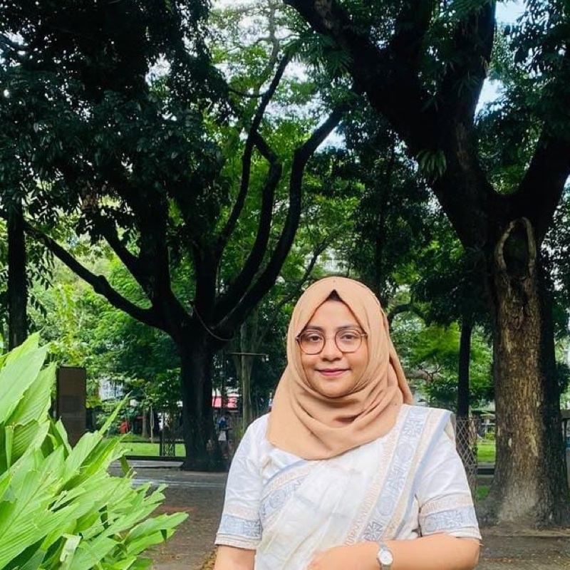
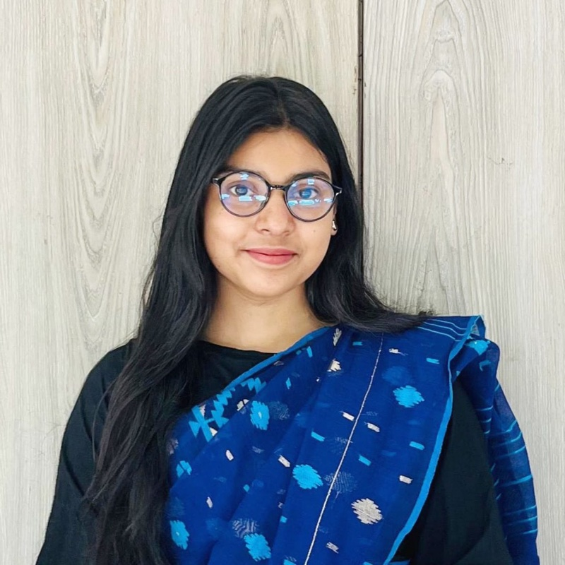
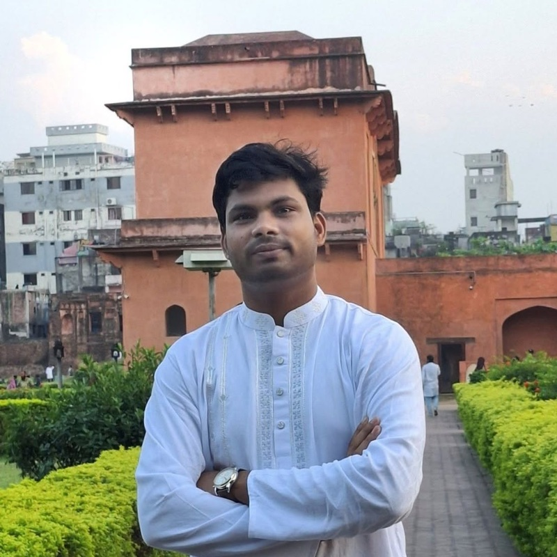
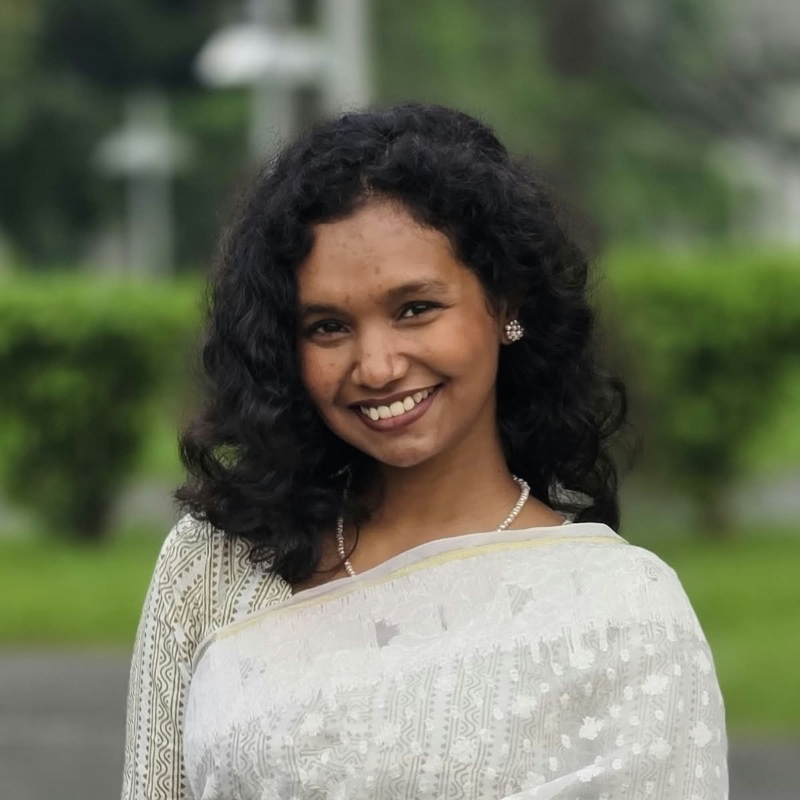

<div align="center">

<br>

# বাংলা বিভাগ গবেষণা সংসদ
### বাংলা বিভাগ · ঢাকা বিশ্ববিদ্যালয়
**অনুসন্ধান থেকে নতুন জ্ঞানের পথে**

<br>

**[ 🏠 প্রধান পাতা ](README.md) &nbsp;•&nbsp; [ 📖 পরিচিতি ](docs/about.md) &nbsp;•&nbsp; [ 👥 কমিটি ](docs/committee.md) &nbsp;•&nbsp; [ 🎯 আয়োজন ](docs/events.md) &nbsp;•&nbsp; [ 📚 আর্কাইভ ](docs/archive.md) &nbsp;•&nbsp; [ 🖼️ গ্যালারি ](docs/gallery.md) &nbsp;•&nbsp; [ ✉️ যোগাযোগ ](docs/contact.md)**

---

</div>

<p align="center">
  
</p>

## 🏛️ আমাদের সম্পর্কে
**বাংলা বিভাগ গবেষণা সংসদ** ঢাকা বিশ্ববিদ্যালয়ের বাংলা বিভাগের বর্তমান শিক্ষার্থীদের জ্ঞানচর্চা, গবেষণা-দক্ষতা এবং সৃজনশীল সংলাপের মুক্ত পরিসর প্রসারিত করতে কাজ করে। কর্মশালা, বিশেষ বক্তৃতা, পাঠচক্র, গবেষণা-উপস্থাপনা ও প্রকাশনার মধ্য দিয়ে আমরা বাংলা ভাষা, সাহিত্য ও সংস্কৃতির বহুমাত্রিক অনুসন্ধানকে উৎসাহিত করি।

```
        ┌─────────────────────────────────────────────────────────────┐
        │                 বাংলা বিভাগ গবেষণা সংসদ                      │
        └─────────────────────────────────────────────────────────────┘
                  │                      │                     │
                  ▼                      ▼                     ▼
            ┌───────────┐          ┌───────────┐         ┌───────────┐
            │  ০১. জ্ঞানচর্চা │          │  ০২. দক্ষতা  │         │  ০৩. সহযোগিতা│
            │  বিষয়ভিত্তিক পাঠ│          │  গবেষণা পদ্ধতি │         │শিক্ষার্থী-শিক্ষক│
            └───────────┘          └───────────┘         └───────────┘
```
👉 [সংসদের লক্ষ্য, উদ্দেশ্য ও দর্শন সম্পর্কে বিস্তারিত পড়ুন ➔](docs/about.md)

---

## 🎯 বর্তমান ও সাম্প্রতিক আয়োজন

<div align="center">

### **বাংলাদেশের ফোকলোর: ঐতিহ্য ও সাম্প্রতিক প্রবণতা**
**তারিখ:** ১৮ নভেম্বর ২০২৬ &nbsp;|&nbsp; **স্থান:** শহিদ মুনীর চৌধুরী শ্রেণিকক্ষ (কলাভবন ২০৬৮)

</div>

> **সেশন বক্তা:**  
> **সাইমন জাকারিয়া, পিএইচডি** *(বিশিষ্ট ফোকলোর গবেষক ও নাট্যকার)*  
> *"লোকঐতিহ্যের নিবিড় পাঠ থেকে সমকালীন গবেষণার নতুন প্রশ্ন ও পদ্ধতির সন্ধান মেলে।"*

- **রেজিস্ট্রেশন ও বিবরণ:** বিস্তারিত তথ্য, সময়সূচি ও ফি সম্পর্কে জানতে [আয়োজন পাতা দেখুন ➔](docs/events.md)
- **আলোকচিত্র গ্যালারি:** কর্মশালার সেশন, প্রশ্নোত্তর ও সমাপনী মুহূর্তের ১৫টি ছবি সংরক্ষিত আছে [গ্যালারি পাতায় ➔](docs/gallery.md)

---

## 👥 নেতৃত্ব ও পরিচালনা পর্ষদ

### মডারেশন পর্ষদ
<div align="center">

| <br>**জনাব রাফাত আলম, পিএইচডি** | <br>**জনাব জোবায়ের আবদুল্লাহ** |
| :---: | :---: |
| **মডারেটর**<br>সহকারী অধ্যাপক, বাংলা বিভাগ | **কো-মডারেটর**<br>সহকারী অধ্যাপক, বাংলা বিভাগ |

</div>

### কার্যনির্বাহী পরিষদ (সংক্ষিপ্ত)

| <br>**তানভীর আহমেদ** | <br>**নাহিন মুনতাহা** | <br>**উম্মে হাবিবা হ্যাপী** | <br>**আবুল বাসার** | <br>**জান্নাতুল ফেরদৌস দিপ্তী** |
| :---: | :---: | :---: | :---: | :---: |
| সভাপতি | সাধারণ সম্পাদক | অর্থ সম্পাদক | দপ্তর সম্পাদক | প্রচার সম্পাদক |

👉 [পূর্ণাঙ্গ কমিটি ও দায়িত্ব বণ্টন দেখতে ক্লিক করুন ➔](docs/committee.md)

---

## 📑 ওয়েবসাইটের পাতাসমূহ (Site Directory)

আপনি এই রিপোজিটরির ভেতরেই একটি পূর্ণাঙ্গ ওয়েবসাইটের মতো সকল পাতায় সরাসরি যেতে পারেন:

| পাতা | বিবরণ | লিংক |
| :--- | :--- | :---: |
| **📖 পরিচিতি ও লক্ষ্য** | সংসদের ইতিহাস, উদ্দেশ্য ও ৩টি মূল ভিত্তি | [দেখুন ➔](docs/about.md) |
| **👥 কমিটি ও নেতৃত্ব** | মডারেশন পর্ষদ ও কার্যনির্বাহী কমিটির সদস্য তালিকা | [দেখুন ➔](docs/committee.md) |
| **🎯 আয়োজন ও কর্মশালা** | বর্তমান কর্মশালার তথ্য, সময়সূচি ও বক্তা পরিচিতি | [দেখুন ➔](docs/events.md) |
| **📚 আয়োজনের আর্কাইভ** | বিগত সকল কর্মশালা ও পোস্টারের তালিকা | [দেখুন ➔](docs/archive.md) |
| **🖼️ আলোকচিত্র গ্যালারি** | বিভিন্ন আয়োজনের নির্বাচিত ছবির প্রদর্শনী | [দেখুন ➔](docs/gallery.md) |
| **✉️ যোগাযোগ ও সহায়তা** | প্রতিনিধি তালিকা, ফোন নম্বর ও সোশ্যাল মিডিয়া | [দেখুন ➔](docs/contact.md) |

---

## 🌐 সংযুক্ত থাকুন ও যোগাযোগ করুন

- **ফেসবুক পেজ:** [বাংলা বিভাগ গবেষণা সংসদ অফিসিয়াল পেজ](https://www.facebook.com/profile.php?id=61596001335645)
- **ইস্যু / প্রস্তাবনা:** কোনো গবেষণা বা আয়োজন সংক্রান্ত পরামর্শ থাকলে [GitHub Issue খুলুন](https://github.com/izobayer/bangla-gobeshona-sangsad/issues/new)
- **ঠিকানা:** বাংলা বিভাগ, কলাভবন (কক্ষ নং ২০৬৮), ঢাকা বিশ্ববিদ্যালয়, ঢাকা-১০০০।

<br>

<div align="center">
<sub>© বাংলা বিভাগ গবেষণা সংসদ · ঢাকা বিশ্ববিদ্যালয় | সর্বস্বত্ব সংরক্ষিত</sub>
</div>
