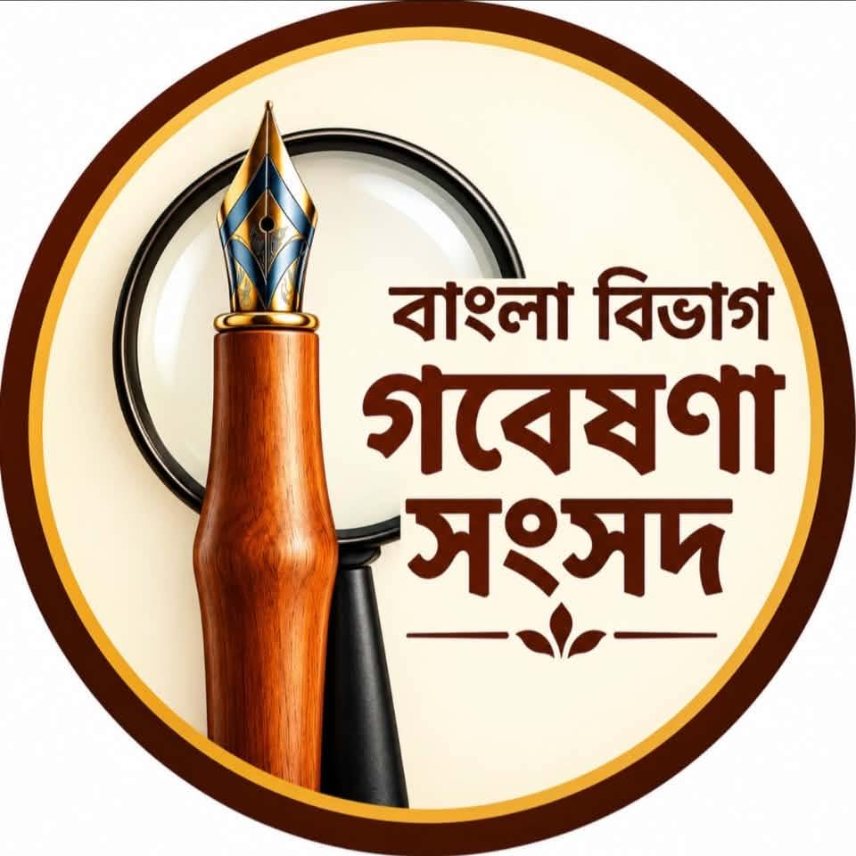

<div align="center">

<a href="../README.md"></a>

# 📖 পরিচিতি ও লক্ষ্য
### বাংলা বিভাগ গবেষণা সংসদ · ঢাকা বিশ্ববিদ্যালয়

---

[🏠 প্রধান পাতা](../README.md) &nbsp;•&nbsp;
**[📖 পরিচিতি](about.md)** &nbsp;•&nbsp;
[👥 কমিটি](committee.md) &nbsp;•&nbsp;
[🎯 আয়োজন](events.md) &nbsp;•&nbsp;
[📚 আর্কাইভ](archive.md) &nbsp;•&nbsp;
[🖼️ গ্যালারি](gallery.md) &nbsp;•&nbsp;
[✉️ যোগাযোগ](contact.md)

---

</div>

<br>

## 🏛️ আমাদের পরিচয়
**বাংলা বিভাগ গবেষণা সংসদ** ঢাকা বিশ্ববিদ্যালয়ের বাংলা বিভাগের শিক্ষার্থী, গবেষক ও শিক্ষকদের একটি প্রাতিষ্ঠানিক ও সহযোগিতামূলক জ্ঞানচর্চার মুক্ত পরিসর। গবেষণা কেবল তত্ত্বীয় মুখস্থকরণ নয়, বরং সমাজ, ইতিহাস, ভাষা ও সাহিত্যের গভীরে গিয়ে প্রশ্ন তোলার একটি জীবন্ত অভ্যাস—এই প্রত্যয় নিয়েই এই সংসদের পথচলা।

আমরা বিশ্বাস করি, তরুণ শিক্ষার্থীদের মধ্য থেকেই ভবিষ্যতের শীর্ষ গবেষক ও বুদ্ধিজীবী তৈরি হবে। সেই লক্ষ্যকে সামনে রেখে গবেষণা পদ্ধতি, তথ্য সংগ্রহ, উপাত্ত বিশ্লেষণ এবং একাডেমিক প্রবন্ধ লেখার সঠিক পথনির্দেশনা দিতে সংসদ ধারাবাহিকভাবে কাজ করে যাচ্ছে।

---

## 🎯 আমাদের মূল তিন স্তম্ভ

```
┌─────────────────────────────────────────────────────────────┐
│                 বাংলা বিভাগ গবেষণা সংসদ                      │
└─────────────────────────────────────────────────────────────┘
          │                      │                     │
          ▼                      ▼                     ▼
    ┌───────────┐          ┌───────────┐         ┌───────────┐
    │  ০১. জ্ঞানচর্চা │          │  ০২. দক্ষতা  │         │  ০৩. সহযোগিতা│
    └───────────┘          └───────────┘         └───────────┘
```

### ০১. জ্ঞানচর্চা
- বিষয়ভিত্তিক আলোচনা, সেমিনার ও পাঠচক্রের ধারাবাহিক আয়োজন।
- বাংলা সাহিত্য, ভাষা ও সংস্কৃতির চিরায়ত ও সমকালীন দিক নিয়ে বহুমুখী দৃষ্টিভঙ্গির বিকাশ।
- ঐতিহ্য ও আধুনিকতার মেলবন্ধন ঘটিয়ে নতুন গবেষণার ক্ষেত্র চিহ্নিতকরণ।

### ০২. দক্ষতা
- একাডেমিক গবেষণা-পদ্ধতি (Research Methodology) ও লিটারেচার রিভিউ প্রশিক্ষণ।
- তথ্যসংগ্রহ, মাঠসমীক্ষা ও উপাত্ত বিশ্লেষণের বাস্তবিক অনুশীলন।
- জাতীয় ও আন্তর্জাতিক মানসম্পন্ন জার্নালে প্রকাশনার উপযোগী পাণ্ডুলিপি প্রস্তুতকরণ।

### ০৩. সহযোগিতা
- স্নাতক ও স্নাতকোত্তর পর্যায়ের শিক্ষার্থীদের সাথে গবেষক ও শিক্ষকদের সরাসরি সংযোগ।
- ঢাকা বিশ্ববিদ্যালয়ের দেশ-বিদেশে অবস্থানরত অ্যালামনাইদের অভিজ্ঞতা তরুণদের মাঝে ছড়িয়ে দেওয়া।
- সহকর্মী-পর্যালোচনা (Peer Review) ও মুক্ত বুদ্ধিবৃত্তিক আদান-প্রদান।

---

## 🔍 গবেষণার আগ্রহের ক্ষেত্রসমূহ

1. **ভাষা ও উপভাষা গবেষণা:** বাংলা উপভাষার বৈচিত্র্য, ধ্বনিতত্ত্ব, রূপতত্ত্ব ও মাঠসমীক্ষা।
2. **ডিজিটাল হিউম্যানিটিজ ও ভাষা প্রযুক্তি:** টেক্সট মাইনিং, কর্পাস ভাষাতত্ত্ব এবং ডিজিটাল আর্কাইভিং।
3. **লোকসাহিত্য ও সংস্কৃতি (ফোকলোর):** বাংলাদেশের লোকঐতিহ্য, লোকনাট্য, গান ও প্রান্তিক সমাজজীবন।
4. **সাহিত্য সমালোচনা ও ইতিহাস:** প্রাচীন, মধ্যযুগ ও আধুনিক বাংলা সাহিত্যের নতুন পাঠ-বিশ্লেষণ।
5. **তুলনামূলক সাহিত্য ও অনুবাদচর্চা:** বিশ্বসাহিত্যের প্রেক্ষাপটে বাংলা সাহিত্যের তুলনামূলক পর্যালোচনা।

---

<br>

<div align="center">
  <a href="../README.md">← মূল পাতায় ফিরে যান</a> &nbsp;|&nbsp; <a href="committee.md">পরবর্তী পাতা: কমিটি ও নেতৃত্ব →</a>
  <br><br>
  <sub>© বাংলা বিভাগ গবেষণা সংসদ | ঢাকা বিশ্ববিদ্যালয়</sub>
</div>
