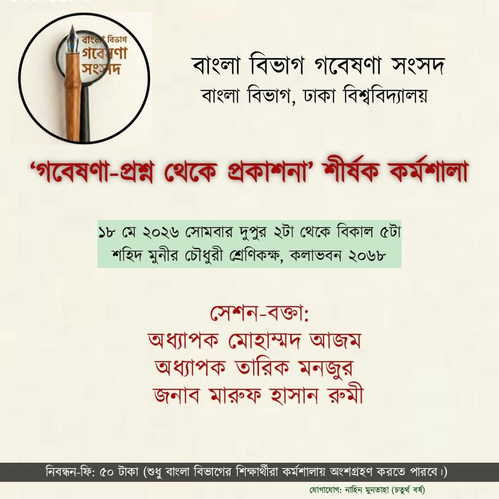

# 📚 আয়োজনের আর্কাইভ
### বাংলা বিভাগ গবেষণা সংসদ · ঢাকা বিশ্ববিদ্যালয়

---

[🏠 প্রধান পাতা](../README.md) &nbsp;•&nbsp;
[📖 পরিচিতি](about.md) &nbsp;•&nbsp;
[👥 কমিটি](committee.md) &nbsp;•&nbsp;
[🎯 আয়োজন](events.md) &nbsp;•&nbsp;
**[📚 আর্কাইভ](archive.md)** &nbsp;•&nbsp;
[🖼️ গ্যালারি](gallery.md) &nbsp;•&nbsp;
[✉️ যোগাযোগ](contact.md)

---

 

বাংলা বিভাগ গবেষণা সংসদের সূচনালগ্ন থেকে আয়োজিত কর্মশালা, সেমিনার, বিশেষ বক্তৃতা ও গবেষণা-উপস্থাপনার তথ্য সময়ানুক্রমিকভাবে এখানে সংরক্ষিত রয়েছে।

---

## 🗃️ সংরক্ষিত আয়োজনসমূহ

### ০১. বাংলাদেশের ফোকলোর: ঐতিহ্য ও সাম্প্রতিক প্রবণতা
- **ধরন:** গবেষণা কর্মশালা
- **তারিখ:** ১৮ নভেম্বর ২০২৬
- **সেশন বক্তা:** সাইমন জাকারিয়া, পিএইচডি *(ফোকলোর গবেষক ও নাট্যকার)*
- **স্থান:** শহিদ মুনীর চৌধুরী শ্রেণিকক্ষ (কলাভবন ২০৬৮)
- **বিবরণ:** লোকঐতিহ্যের পাঠ থেকে সমকালীন গবেষণার নতুন প্রশ্ন ও পদ্ধতির সন্ধান। কর্মশালায় সেশন, প্রশ্নোত্তর এবং সমাপনী পর্ব অনুষ্ঠিত হয়।
- **সংযুক্তিসমূহ:** [আয়োজনের বিবরণ](events.md) &nbsp;|&nbsp; [আলোকচিত্র গ্যালারি](gallery.md)

---

### ০২. গবেষণা-প্রশ্ন থেকে প্রকাশনা

  

- **ধরন:** একাডেমিক প্রশিক্ষণ কর্মশালা
- **তারিখ:** ১৮ মে ২০২৬ (সোমবার)
- **সময়:** দুপুর ২:০০ টা – বিকাল ৫:০০ টা
- **স্থান:** শহিদ মুনীর চৌধুরী শ্রেণিকক্ষ (কলাভবন ২০৬৮)
- **অংশগ্রহণকারী:** বাংলা বিভাগের শিক্ষার্থীবৃন্দ
- **নিবন্ধন ফি:** ৫০ টাকা

#### 🎙️ সম্মানিত সেশন-বক্তাগণ:
1. **অধ্যাপক মোহাম্মদ আজম**  
   *মহাপরিচালক, বাংলা একাডেমি এবং অধ্যাপক, বাংলা বিভাগ, ঢাকা বিশ্ববিদ্যালয়*
2. **অধ্যাপক তারিক মনজুর**  
   *অধ্যাপক, বাংলা বিভাগ, ঢাকা বিশ্ববিদ্যালয়*
3. **মারুফ হাসান রুমী**  
   *পিএইচডি শিক্ষার্থী, টেক্সাস টেক ইউনিভার্সিটি এবং সহকারী অধ্যাপক, বাংলা বিভাগ, ঢাকা বিশ্ববিদ্যালয়*

#### 📝 সেশনের মূল বিষয়বস্তু:
- কীভাবে একটি মৌলিক গবেষণা প্রশ্ন (Research Question) তৈরি করতে হয়।
- তথ্যসূত্র ও প্রাথমিক উৎসের সন্ধান ও যাচাইকরণ।
- একাডেমিক লেখার কাঠামো, সাইটেশন ও রেফারেন্সিং শৈলী।
- মানসম্পন্ন গবেষণা জার্নালে প্রকাশের জন্য পাণ্ডুলিপি প্রস্তুত ও পর্যালোচনা প্রক্রিয়া।

---

## 🗂️ আর্কাইভ সংরক্ষণ নির্দেশিকা
ভবিষ্যতের যেকোনো আয়োজন সম্পন্ন হওয়ার পর সংসদের দপ্তর থেকে নিম্নলিখিত তথ্যাদি এই আর্কাইভে যুক্ত করা হয়:
- আয়োজনের চূড়ান্ত পোস্টার ও ব্যানার
- আলোচক ও বিষয়সূচি
- কার্যবিবরণী ও সংক্ষিপ্ত প্রতিবেদন
- ছবি ও প্রেস বিজ্ঞপ্তি

---

 

  <a href="events.md">← পূর্ববর্তী পাতা: আয়োজন</a> &nbsp;|&nbsp; <a href="../README.md">মূল পাতা</a> &nbsp;|&nbsp; <a href="gallery.md">পরবর্তী পাতা: আলোকচিত্র গ্যালারি →</a>
    
  © বাংলা বিভাগ গবেষণা সংসদ | ঢাকা বিশ্ববিদ্যালয়

