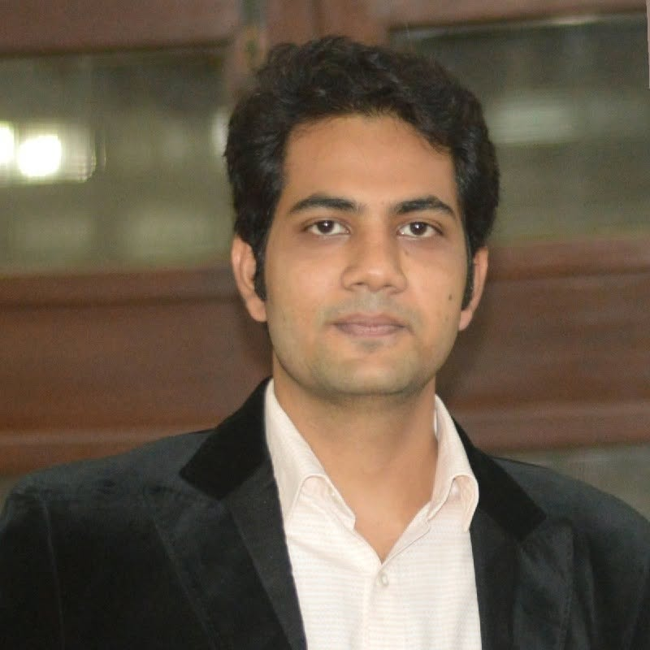

# 👥 কমিটি ও নেতৃত্ব
### বাংলা বিভাগ গবেষণা সংসদ · ঢাকা বিশ্ববিদ্যালয়

---

[🏠 প্রধান পাতা](../README.md) &nbsp;•&nbsp;
[📖 পরিচিতি](about.md) &nbsp;•&nbsp;
**[👥 কমিটি](committee.md)** &nbsp;•&nbsp;
[🎯 আয়োজন](events.md) &nbsp;•&nbsp;
[📚 আর্কাইভ](archive.md) &nbsp;•&nbsp;
[🖼️ গ্যালারি](gallery.md) &nbsp;•&nbsp;
[✉️ যোগাযোগ](contact.md)

---

 

## 🎓 মডারেশন পর্ষদ

সংসদের সামগ্রিক দিকনির্দেশনা, প্রাতিষ্ঠানিক মানদণ্ড ও একাডেমিক তত্ত্বাবধানে নিয়োজিত রয়েছেন বাংলা বিভাগের সম্মানিত শিক্ষকবৃন্দ:

|  **জনাব রাফাত আলম, পিএইচডি** |  **জনাব জোবায়ের আবদুল্লাহ** |
| :---: | :---: |
| **মডারেটর** | **কো-মডারেটর** |
| সহকারী অধ্যাপক বাংলা বিভাগ, ঢাকা বিশ্ববিদ্যালয় | সহকারী অধ্যাপক বাংলা বিভাগ, ঢাকা বিশ্ববিদ্যালয় |

---

## 🏛️ কার্যনির্বাহী পরিষদ

সংসদের যাবতীয় কার্যক্রম, কর্মশালা সমন্বয় ও সাংগঠনিক কর্মকাণ্ড পরিচালনার দায়িত্ব পালন করছে কার্যনির্বাহী পরিষদ:

### শীর্ষ নেতৃত্ব

|  **তানভীর আহমেদ** | 
না
 **নাহিন মুনতাহা** |
| :---: | :---: |
| **সভাপতি** | **সাধারণ সম্পাদক** |
| বাংলা বিভাগ, ঢাকা বিশ্ববিদ্যালয় | বাংলা বিভাগ, ঢাকা বিশ্ববিদ্যালয় |

 

### সম্পাদকীয় পরিষদ

| কর্মকর্তা | পদবী | বিভাগ ও প্রতিষ্ঠান |
| :--- | :--- | :--- |
| **উম্মে হাবিবা হ্যাপী** | অর্থ সম্পাদক | বাংলা বিভাগ, ঢাকা বিশ্ববিদ্যালয় |
| **আবুল বাসার** | দপ্তর সম্পাদক | বাংলা বিভাগ, ঢাকা বিশ্ববিদ্যালয় |
| **জান্নাতুল ফেরদৌস দিপ্তী** | প্রচার সম্পাদক | বাংলা বিভাগ, ঢাকা বিশ্ববিদ্যালয় |

---

## 📋 দায়িত্ব ও কাজের পরিধি
- **মডারেশন পর্ষদ:** একাডেমিক মান নিয়ন্ত্রণ, রিসোর্স পার্সন ও বক্তা নির্ধারণ, প্রকাশনা মূল্যায়ন ও প্রশাসনিক দিকনির্দেশনা।
- **সভাপতি ও সাধারণ সম্পাদক:** সাংগঠনিক নেতৃত্ব, বার্ষিক পরিকল্পনা প্রণয়ন, প্রাতিষ্ঠানিক যোগাযোগ ও অধিবেশন পরিচালনা।
- **অর্থ সম্পাদক:** বাজেট প্রণয়ন, তহবিল ব্যবস্থাপনা এবং আয়-ব্যয়ের স্বচ্ছ হিসাব সংরক্ষণ।
- **দপ্তর সম্পাদক:** সভার কার্যবিবরণী সংরক্ষণ, দাপ্তরিক নথিপত্র ব্যবস্থাপনা ও সদস্য তালিকা সংরক্ষণ।
- **প্রচার সম্পাদক:** প্রকাশনা, পোস্টার, সামাজিক যোগাযোগমাধ্যম ও প্রচারমূলক সামগ্রী প্রস্তুত ও বিতরণ।

---

 

  <a href="about.md">← পূর্ববর্তী পাতা: পরিচিতি</a> &nbsp;|&nbsp; <a href="../README.md">মূল পাতা</a> &nbsp;|&nbsp; <a href="events.md">পরবর্তী পাতা: আয়োজন ও কর্মশালা →</a>
    
  © বাংলা বিভাগ গবেষণা সংসদ | ঢাকা বিশ্ববিদ্যালয়

