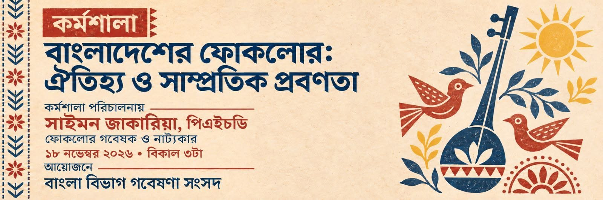

# 🎯 আয়োজন ও কর্মশালা
### বাংলা বিভাগ গবেষণা সংসদ · ঢাকা বিশ্ববিদ্যালয়

---

[🏠 প্রধান পাতা](../README.md) &nbsp;•&nbsp;
[📖 পরিচিতি](about.md) &nbsp;•&nbsp;
[👥 কমিটি](committee.md) &nbsp;•&nbsp;
**[🎯 আয়োজন](events.md)** &nbsp;•&nbsp;
[📚 আর্কাইভ](archive.md) &nbsp;•&nbsp;
[🖼️ গ্যালারি](gallery.md) &nbsp;•&nbsp;
[✉️ যোগাযোগ](contact.md)

---

 

  

## 📌 সাম্প্রতিক কর্মশালা
### **বাংলাদেশের ফোকলোর: ঐতিহ্য ও সাম্প্রতিক প্রবণতা**

বাংলা বিভাগ গবেষণা সংসদের নিয়মিত জ্ঞানচর্চা ও গবেষণা দক্ষতা বৃদ্ধির ধারাবাহিকতায় অনুষ্ঠিত হয়েছে ফোকলোর বিষয়ক বিশেষ কর্মশালা। এতে বাংলাদেশের লোকসংস্কৃতি, লোকনাট্য ও আধুনিক ফোকলোর গবেষণা-পদ্ধতি নিয়ে গুরুত্বপূর্ণ আলোচনা অনুষ্ঠিত হয়।

---

### 🎙️ সেশন বক্তা
> **সাইমন জাকারিয়া, পিএইচডি**  
> *বিশিষ্ট ফোকলোর গবেষক ও নাট্যকার*  
> *"লোকঐতিহ্যের নিবিড় পাঠ থেকে সমকালীন গবেষণার নতুন প্রশ্ন ও পদ্ধতির সন্ধান মেলে।"*

---

### 📅 সময় ও স্থান সূচি
| বিবরণ | তথ্য |
| :--- | :--- |
| **তারিখ** | ১৮ নভেম্বর ২০২৬ (বুধবার) |
| **সময়** | বিকাল ৩:০০ টা – ৫:০০ টা |
| **স্থান** | শহিদ মুনীর চৌধুরী শ্রেণিকক্ষ (কলাভবন ২০৬৮), ঢাকা বিশ্ববিদ্যালয় |
| **আয়োজক** | বাংলা বিভাগ গবেষণা সংসদ |

---

### 💡 কর্মশালার মূল আলোচ্য বিষয়
1. বাংলাদেশের মৌখিক ঐতিহ্য ও লোকসাহিত্যের বৈচিত্র্য।
2. ঔপনিবেশিক ও উত্তর-ঔপনিবেশিক ধারায় ফোকলোর অধ্যয়ন।
3. লোকনাট্য, পালাগান ও লোকবিশ্বাস সংরক্ষণে ফিল্ডওয়ার্কের গুরুত্ব।
4. তরুণ গবেষকদের জন্য লোকসংস্কৃতিতে তথ্যসংগ্রহ ও উপাত্ত বিশ্লেষণের পদ্ধতি।

---

### 💳 রেজিস্ট্রেশন ও অংশগ্রহণ বিবরণ
| ক্যাটাগরি | রেজিস্ট্রেশন ফি | যোগ্যতা |
| :--- | :---: | :--- |
| **সংসদের সদস্য** | ১০০ ৳ | বাংলা বিভাগ গবেষণা সংসদের নিবন্ধিত সদস্য |
| **বিভাগের শিক্ষার্থী ও অ্যালামনাই** | ১৫০ ৳ | ঢাবির বাংলা বিভাগের বর্তমান ও সাবেক শিক্ষার্থী |
| **অন্যান্য বিভাগের শিক্ষার্থী** | ২০০ ৳ | ঢাবির যেকোনো বিভাগের বর্তমান শিক্ষার্থী |

#### 📞 রেজিস্ট্রেশন সহায়তা ও যোগাযোগ:
- **সাধারণ সম্পাদক:** নাহিন মুনতাহা (`০১৮৩৫৯৫৯১৪৫`)
- **অর্থ সম্পাদক:** উম্মে হাবিবা হ্যাপী (`০১৭৬২০৮৩২২০`)
- **দপ্তর সম্পাদক:** আবুল বাসার (`০১৩০৯৯০৬৭৪১`)
- **প্রচার সম্পাদক:** জান্নাতুল ফেরদৌস দিপ্তী (`০১৩০৩৮১০৮৮৩`)

> 📷 এই কর্মশালার ১৫টি নির্বাচিত আলোকচিত্র দেখতে [গ্যালারি পাতা দেখুন ➔](gallery.md)

---

 

  <a href="committee.md">← পূর্ববর্তী পাতা: কমিটি</a> &nbsp;|&nbsp; <a href="../README.md">মূল পাতা</a> &nbsp;|&nbsp; <a href="archive.md">পরবর্তী পাতা: আয়োজনের আর্কাইভ →</a>
    
  © বাংলা বিভাগ গবেষণা সংসদ | ঢাকা বিশ্ববিদ্যালয়

