

# 🖼️ আলোকচিত্র গ্যালারি
### বাংলা বিভাগ গবেষণা সংসদ · ঢাকা বিশ্ববিদ্যালয়

---

[🏠 প্রধান পাতা](../README.md) &nbsp;•&nbsp;
[📖 পরিচিতি](about.md) &nbsp;•&nbsp;
[👥 কমিটি](committee.md) &nbsp;•&nbsp;
[🎯 আয়োজন](events.md) &nbsp;•&nbsp;
[📚 আর্কাইভ](archive.md) &nbsp;•&nbsp;
**[🖼️ গ্যালারি](gallery.md)** &nbsp;•&nbsp;
[✉️ যোগাযোগ](contact.md)

---

 

## 📸 ফোকলোর কর্মশালার নির্বাচিত মুহূর্ত
> **তারিখ:** ১৮ নভেম্বর ২০২৬ &nbsp;|&nbsp; **স্থান:** শহিদ মুনীর চৌধুরী শ্রেণিকক্ষ (কলাভবন ২০৬৮)  
> *বাংলাদেশের ফোকলোরের ঐতিহ্য, লোকনাট্য ও সাম্প্রতিক গবেষণা-প্রবণতা নিয়ে সাইমন জাকারিয়া, পিএইচডির সেশন, প্রশ্নোত্তর এবং সমাপনী পর্বের আলোকচিত্র।*

---

| 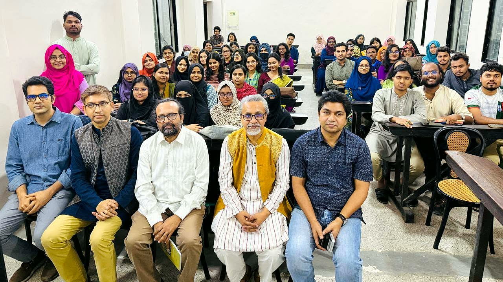 <b>কর্মশালা শেষে অতিথি, আয়োজক ও অংশগ্রহণকারীদের যৌথ দলীয় আলোকচিত্র</b> |
| :---: |

 

| 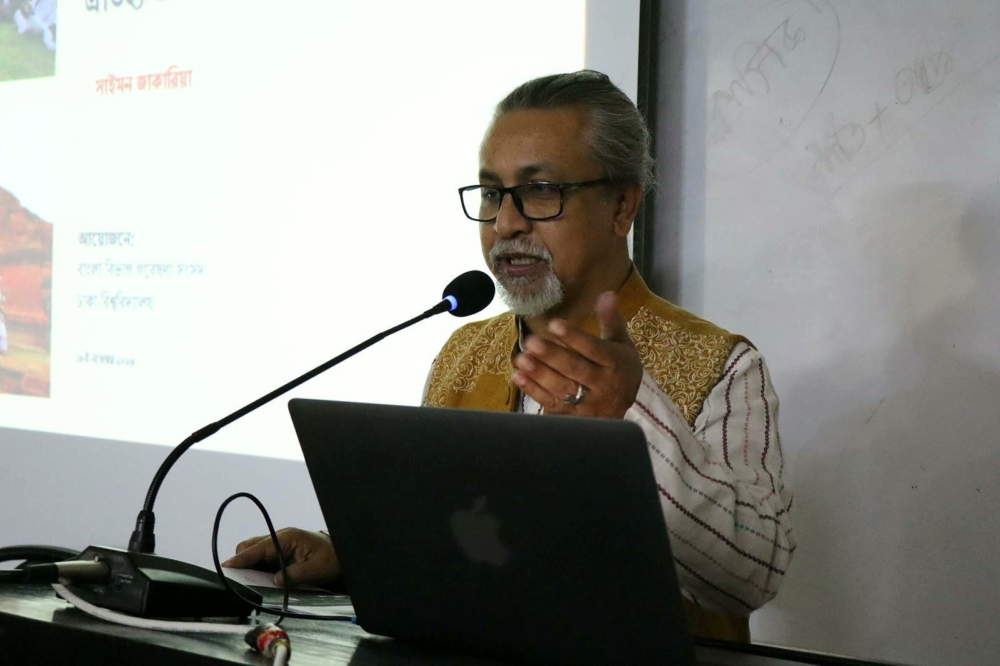 ০১. কর্মশালার সেশনে বক্তব্য রাখছেন সাইমন জাকারিয়া | 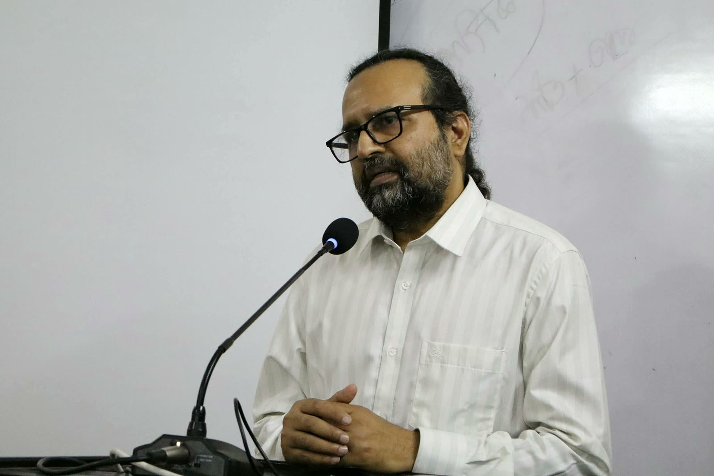 ০২. কর্মশালার উদ্বোধনী পর্বের বক্তব্য |
| :---: | :---: |
| 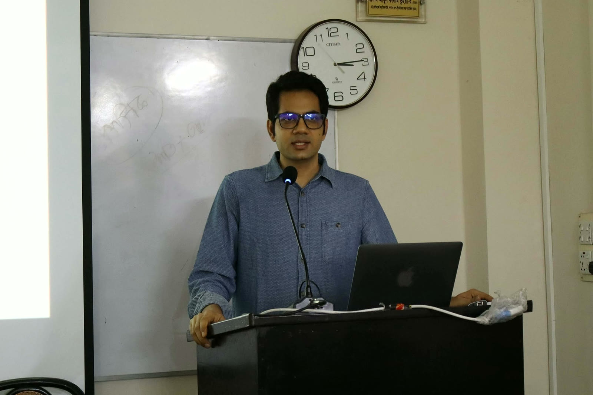 ০৩. আয়োজকদের পক্ষ থেকে কর্মশালার সূচনা | 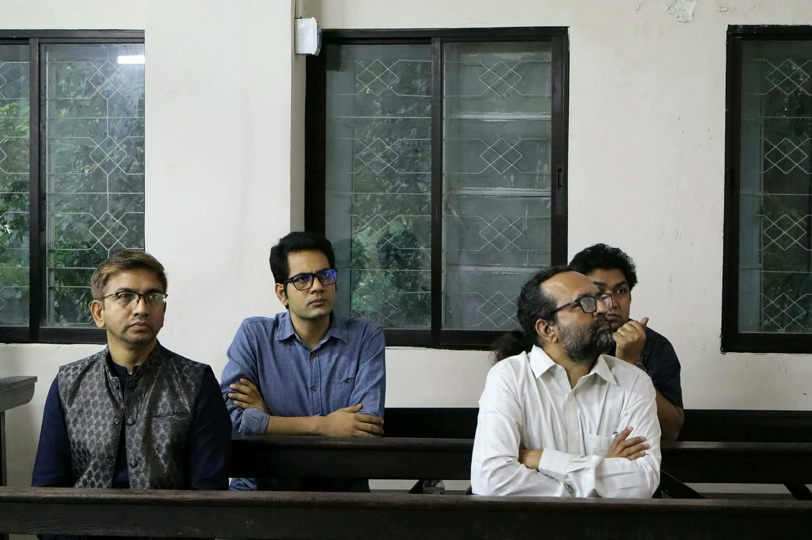 ০৪. মনোযোগ দিয়ে সেশন শুনছেন শিক্ষক ও অংশগ্রহণকারীরা |
| 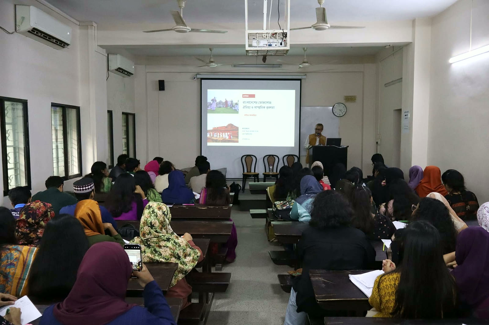 ০৫. শ্রেণিকক্ষে কর্মশালার পূর্ণাঙ্গ সেশন | 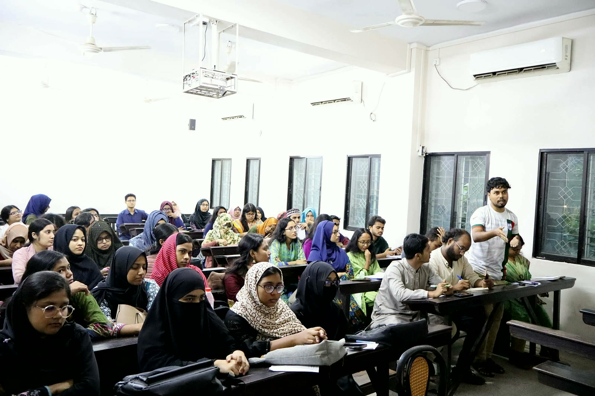 ০৬. প্রশ্নোত্তর পর্বে মতামত জানাচ্ছেন একজন অংশগ্রহণকারী |
| 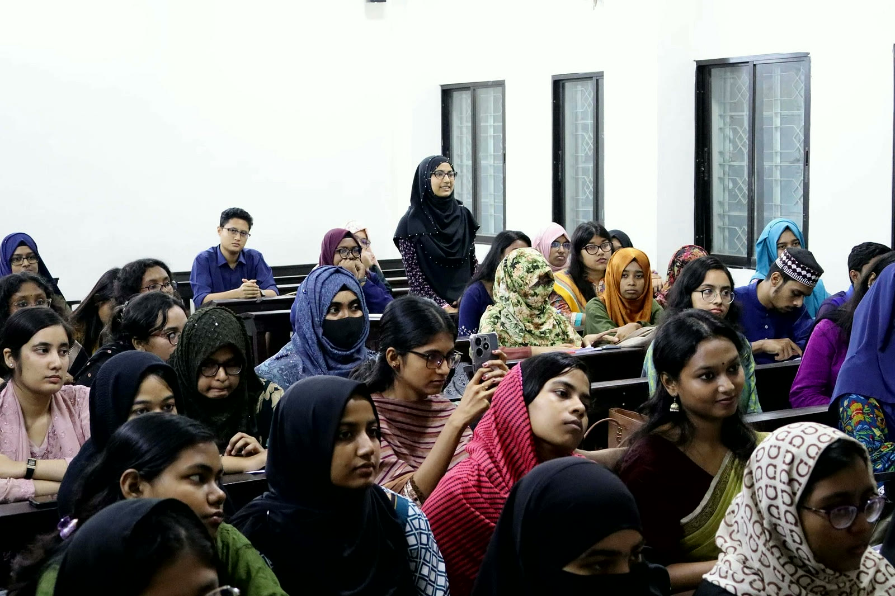 ০৭. অংশগ্রহণকারীদের প্রশ্ন ও আলোচনায় প্রাণবন্ত সেশন | 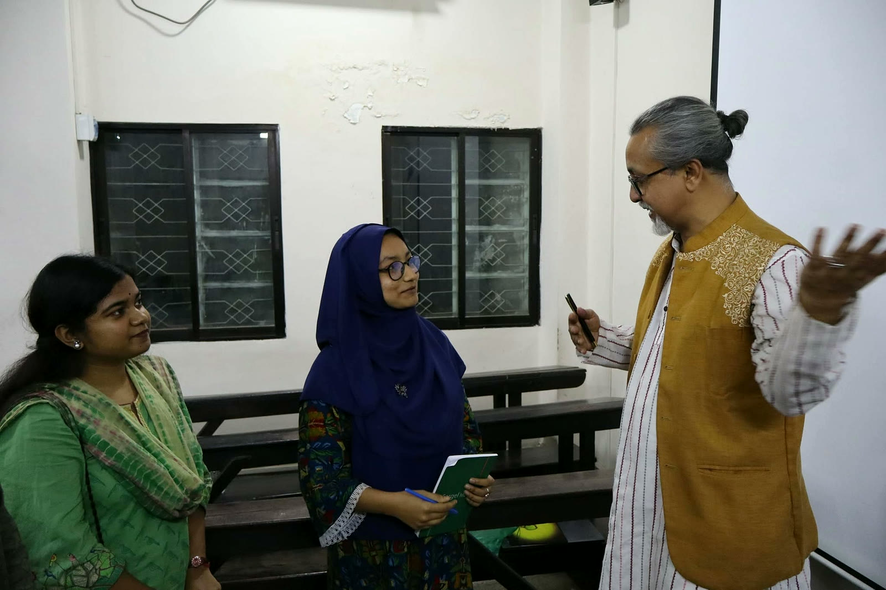 ০৮. সেশন শেষে অংশগ্রহণকারীদের সঙ্গে অন্তরঙ্গ আলাপ |
| 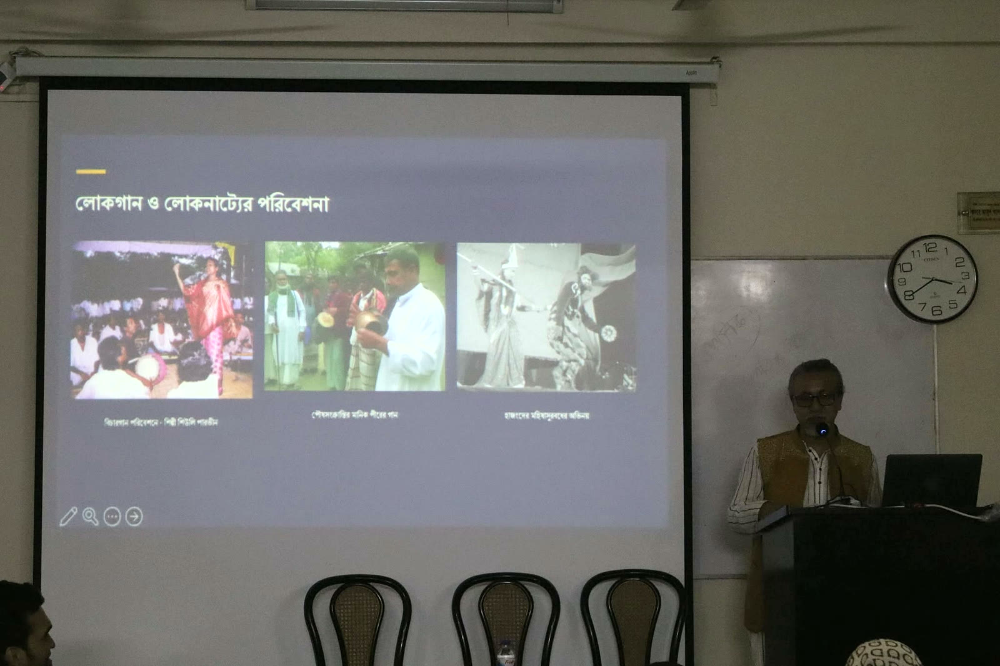 ০৯. লোকগান ও লোকনাট্যের পরিবেশনা নিয়ে উপস্থাপনা | 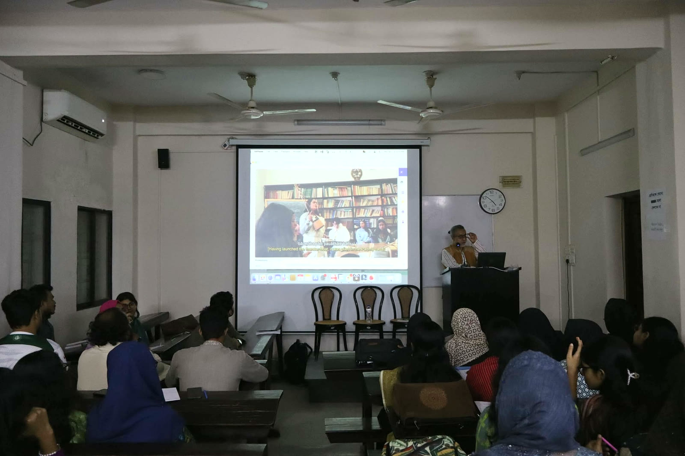 ১০. অংশগ্রহণকারীদের হাতে সনদ ও শুভেচ্ছা স্মারক প্রদান |
| 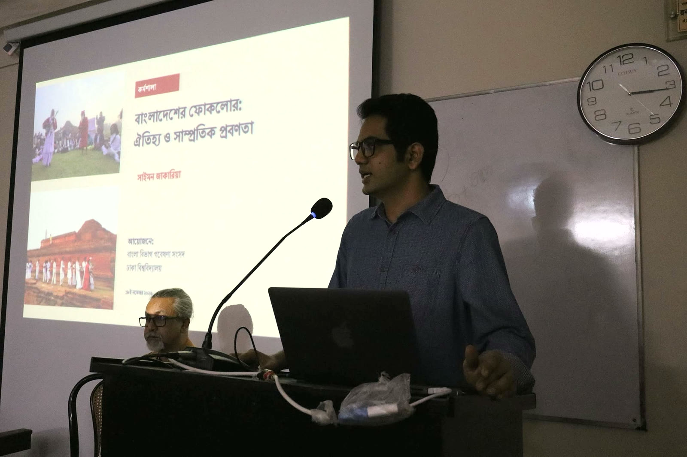 ১১. সমাপনী আলোচনা ও কর্মশালার প্রাতিষ্ঠানিক মূল্যায়ন | 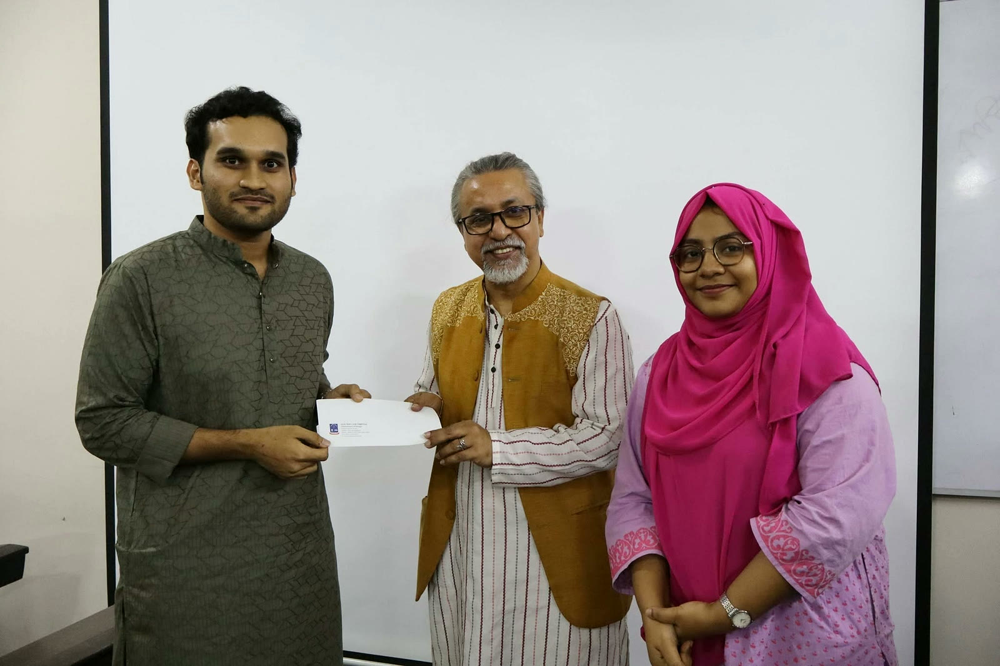 ১২. সমাপনী পর্বে সম্মানিত অতিথিকে শুভেচ্ছা স্মারক প্রদান |
| 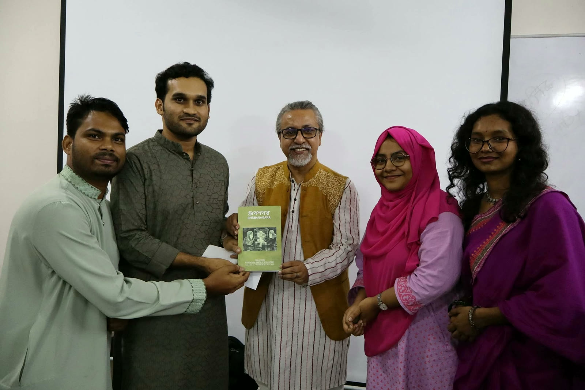 ১৩. অতিথির হাতে গবেষণা প্রকাশনা তুলে দিচ্ছেন আয়োজকেরা | 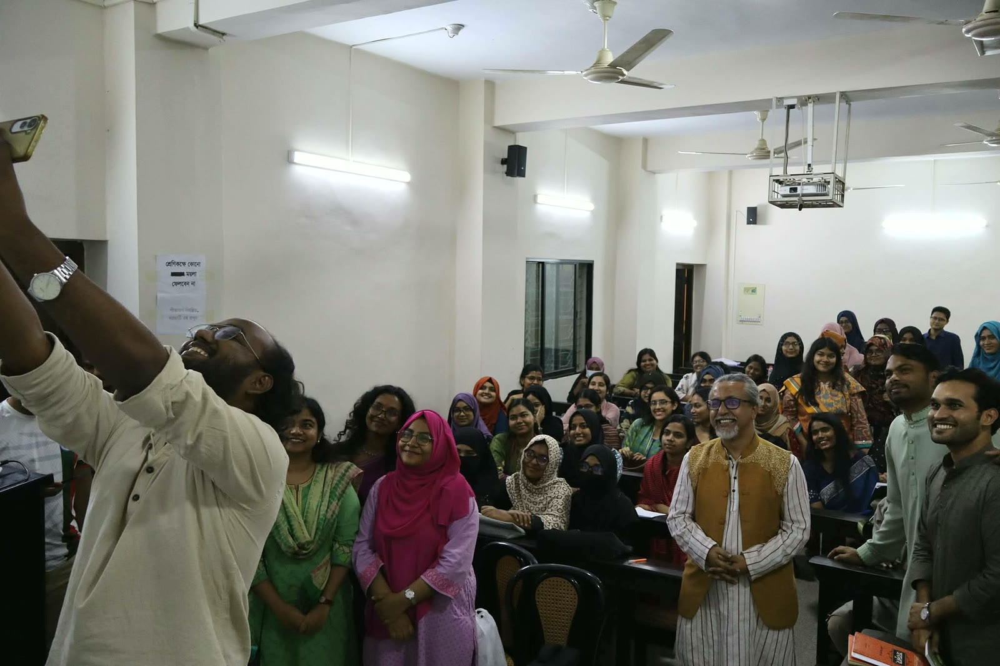 ১৫. আনন্দঘন পরিবেশে উৎসবমুখর সমাপ্তি |

---

 

  <a href="archive.md">← পূর্ববর্তী পাতা: আর্কাইভ</a> &nbsp;|&nbsp; <a href="../README.md">মূল পাতা</a> &nbsp;|&nbsp; <a href="contact.md">পরবর্তী পাতা: যোগাযোগ →</a>
    
  © বাংলা বিভাগ গবেষণা সংসদ | ঢাকা বিশ্ববিদ্যালয়

